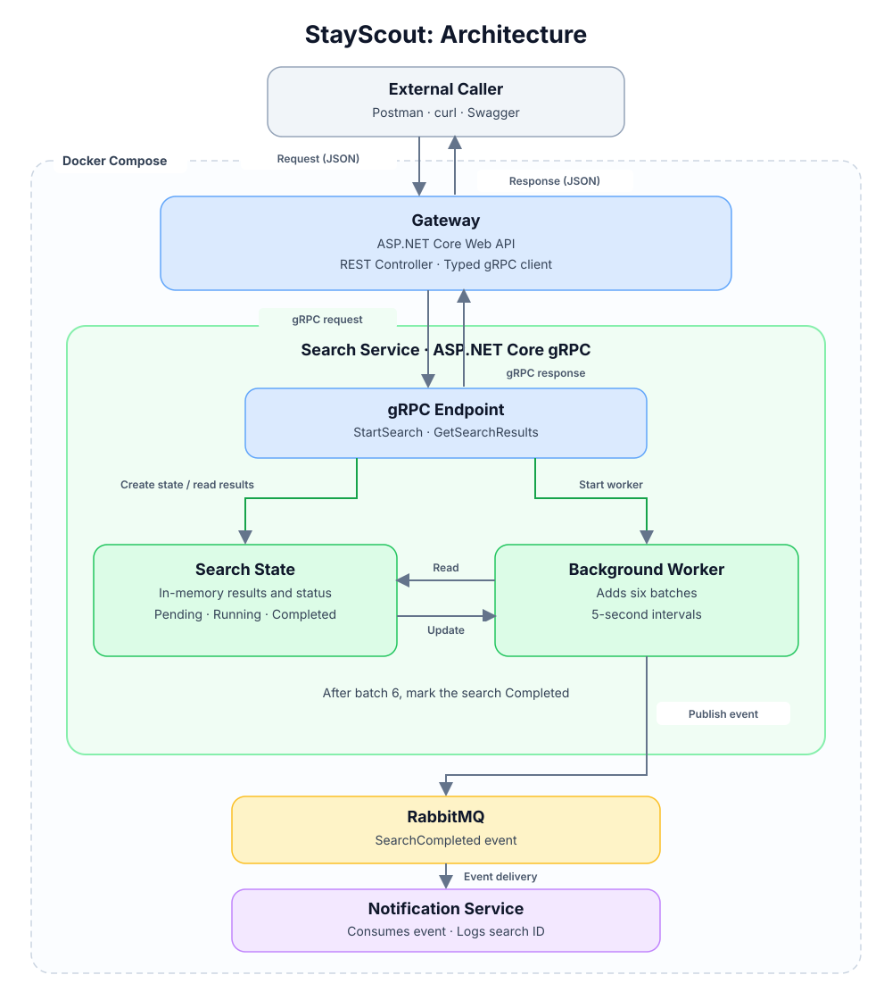

# StayScout

Asynchronous hotel search built from three services on .NET and ASP.NET Core:

- **Gateway** accepts HTTP/JSON requests and talks to the Search Service over gRPC.
- **Search Service** runs a search in six batches, five seconds apart, and stores the results in Postgres.
- **Notification Service** receives a `SearchCompleted` event from RabbitMQ and logs the search ID.

A fourth project, **Housekeeping**, is a one-shot job that applies the database migrations and creates the RabbitMQ exchanges and queues before the services start.



## How it works

1. `POST /api/searches` reaches the Gateway, which calls `StartSearch` on the Search Service over gRPC.
2. The Search Service stores a new search (`Pending`), publishes `SearchRequested` to RabbitMQ and returns the search ID immediately.
3. A consumer inside the Search Service receives `SearchRequested` and saves six batches of hotels, waiting five seconds between batches. The search is `Processing` while it runs.
4. Saving the sixth batch marks the search `Completed` in the same database transaction as the batch itself.
5. The Search Service publishes `SearchCompleted` to RabbitMQ.
6. The Notification Service consumes the event and logs the search ID.
7. `GET /api/searches/{id}` returns the results saved so far and an `isCompleted` flag. Poll it until `isCompleted` is `true`.


## Run it

Requires Docker with Compose v2.

### ⚠️ Required: Configure environment

**You must copy `.env.example` to `.env` before starting Docker Compose.** Without this file, the services will start with an invalid configuration.

```bash
docker compose up --build
```

The Gateway listens on `http://localhost:8080`.

```bash
# start a search
curl -X POST http://localhost:8080/api/searches \
  -H "Content-Type: application/json" \
  -d '{"query": "<City>"}'
# {"searchId": "<id>"}

# poll the results (about 25 seconds until isCompleted is true)
curl http://localhost:8080/api/searches/<id>
```

Watch the notification arrive:

```bash
docker compose logs -f notification-service
```

The RabbitMQ management UI is at `http://localhost:15672` (`guest` / `guest`).

Responses: `400` for an empty query or an invalid search ID, `404` for an unknown search.

## Local development

Start only the infrastructure, then run the services from your IDE:

```bash
docker compose up rabbitmq postgres
docker compose run --rm housekeeping
```

Each service has an `appsettings.Development.json` with localhost values, so the services run without any extra setup. These are throwaway local credentials, and `.env` is committed on purpose.

## Configuration

| Key | Used by | Docker source |
| --- | --- | --- |
| `ConnectionStrings:SearchDatabase` | Search Service, Housekeeping | `SEARCH_DB_CONNECTION` in `.env` |
| `RabbitMq:Uri` | Search Service, Notification Service, Housekeeping | `RABBITMQ_URI` in `.env` |
| `SearchService:Address` | Gateway | set in `docker-compose.yml` |

A missing key fails at startup with a clear message. Real deployments would read these from a secret store (for example AWS Secrets Manager), not from files in the repository.

## Tests

```bash
dotnet test
```

The Search Service integration tests need Postgres and RabbitMQ running (see Local development).

## Design decisions

- **gRPC between Gateway and Search Service.** The Gateway is a normal ASP.NET Core Web API with minimal APIs.
- **A broker inside the Search Service.** `SearchRequested` goes through RabbitMQ to a consumer in the same service. The message is durable, so a search survives a restart and resumes from the last saved batch (`CompletedBatches`) instead of starting over.
- **Postgres with EF Core** stores searches and results. `SaveBatchAsync` is idempotent: it is a conditional update that only succeeds for the next expected batch, so duplicate or concurrent deliveries do not save a batch twice.
- **Atomic completion.** The results, the batch counter and the `Completed` status are written in one transaction.
- **Housekeeping job** applies migrations and creates the queues once, before the services start, so replicas never race on migrations and no event is published into an exchange that has no queue.
- **Mock hotel data.** One in-memory provider returns a fixed list of 30 hotels, split into six equal batches. Hotels matching the query by city or name come first. The list is deterministic, so a retried batch produces the same data.

## Known limitations

This is not production-ready. Known gaps:

- **No outbox.** Starting a search writes to the database and then publishes, and completion commits and then publishes. A crash between the two leaves a search stuck in `Pending`, or loses `SearchCompleted`.
- **No failure handling.** The `Failed` status is never set and no retry policy is configured. A failing message ends up in the `_error` queue and the search stays `Processing`.
- **Duplicate events.** Two concurrent deliveries of the same search can both publish `SearchCompleted`, and the Notification consumer is not idempotent.
- **One provider.** The real system would aggregate several providers and merge duplicate hotels across them (canonical hotel ID, one offer per provider).
- **RabbitMQ was used for ease of running locally.**
- **No auth, no HTTPS in containers, no pagination.** The Gateway is open and returns all results found so far.
- **Incremental results.** Results may change between polls as additional batches are processed.
- **Distributed error handling.** Define consistent error handling across the Gateway, Search Service, RabbitMQ consumers and Notification Service, including how failures are propagated and exposed to clients.
- **Application-level exceptions.** Introduce appropriate application exceptions and consistent mapping of application and infrastructure failures to API responses.
- **Gateway validation.** Add request validation and consistent handling of invalid input.
- **Configuration.** Improve configuration binding, validation and startup-time checks across services.
- **Solution organization.** Review project boundaries and split responsibilities into separate projects where appropriate; several responsibilities currently reside in the same projects.
- **Retries and resilience.** Define retry policies and handling of transient failures for database operations, broker interactions and downstream calls.
- **Atomicity and idempotency.** Review transaction boundaries and duplicate-processing behavior across the complete workflow, not just batch persistence.
- **Testing.** Expand unit, integration and end-to-end coverage across the solution, including application services, mappers, validation, error handling, batch processing, retries, concurrency and recovery after failures.